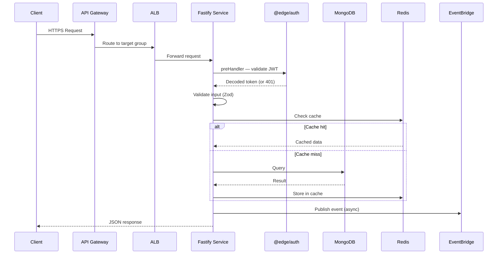
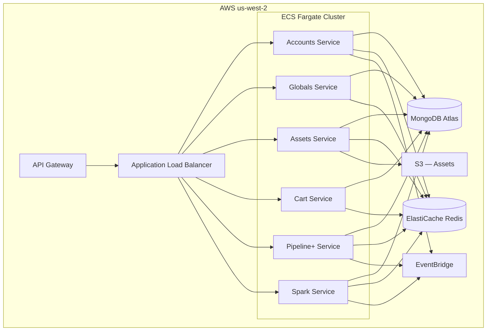
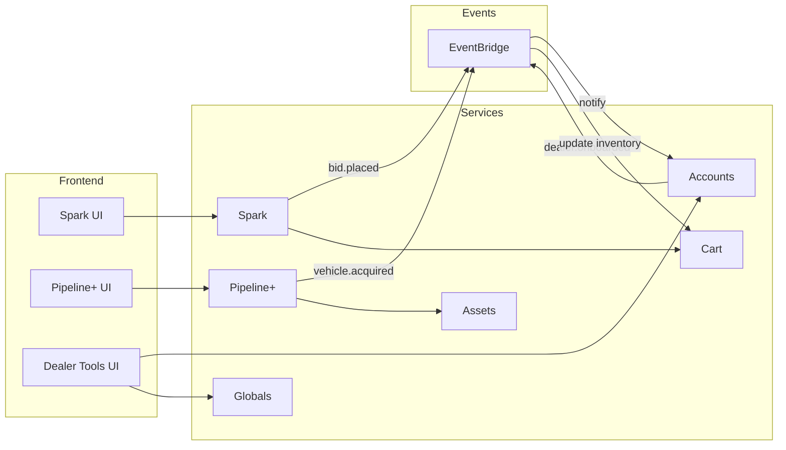
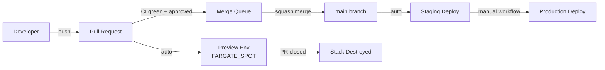

# README-AI.md

> This file is maintained by AI agents and provides detailed architecture documentation for human readers.
> Last updated: 2026-05-14

## Overview

Edge Dev Platform — a pnpm monorepo powering the Edge automotive marketplace. Contains backend REST services (Fastify), shared libraries, React UIs, AWS CDK infrastructure, and CLI tools. Services run on ECS Fargate (Node.js 22) backed by MongoDB Atlas and ElastiCache Redis.

The platform handles wholesale vehicle auctions, dealer-to-dealer transactions, and fleet management.

## Architecture

**ESM monorepo** using pnpm workspaces + Turborepo. TypeScript strict mode throughout. All import paths use `.js` extensions.

**Service pattern**: Each service exports `buildApp()` from `src/server.ts` returning `{ app, db, cache }`. The same file starts the server when run directly. This enables test harnesses to boot the full app without network ports.

### Request Flow



### Infrastructure Topology



### Service Interactions



**Key patterns**:

- **Functional/imperative** — factory functions, plain objects, no OOP/DI containers
- **Native MongoDB driver v6** — `connectDb()` returns `Db` instance, no ORM
- **ioredis** — `lazyConnect: true` with `keyPrefix` per service
- **JWT auth** — `@edge/auth` Fastify `preHandler` hook
- **Typed errors** — `NotFoundError(resource, id)`, `ValidationError`, `ConflictError`
- **Pino logging** — `@edge/logger`, never `console.log`

## Directory Structure

```
services/                        # Backend Fastify services
├── accounts/                    # @edge/accounts-service — dealer accounts, onboarding
├── assets/                      # @edge/assets-service — vehicle media (photos, video)
├── cart/                        # @edge/cart-service — shopping cart with hold expiry
├── globals/                     # @edge/globals-service — platform configuration
├── pipeline-plus/               # @edge/pipeline-plus-service — vehicle acquisition pipeline
└── spark/                       # @edge/spark-service — real-time auction bidding

libs/                            # Shared libraries (workspace: @edge/<name>)
├── auth/                        # @edge/auth — JWT middleware, token generation
├── cache/                       # @edge/cache — Redis connection, caching utilities
├── db/                          # @edge/db — MongoDB connection, helpers
├── errors/                      # @edge/errors — typed error classes
├── events/                      # @edge/events — EventBridge publishing
├── logger/                      # @edge/logger — Pino logger factory
├── types/                       # @edge/types — shared TypeScript types
└── validation/                  # @edge/validation — Zod schemas

apps/                            # React + Vite UIs
├── spark-ui/                    # Real-time auction interface
├── pipeline-plus-ui/            # Vehicle acquisition workflow
└── dealer-tools-ui/             # Dealer management dashboard

infra/                           # AWS CDK stacks
├── shared/                      # VPC, Database, Cache, Gateway, Events, Preview
├── accounts/                    # Per-service ECS Fargate stacks
├── assets/
├── cart/
├── globals/
├── pipeline-plus/
└── spark/

tools/                           # CLI tools
├── soc/                         # Sierra Onboarding CLI (local copy)
├── mongo-sync/                  # Sync data from staging MongoDB
└── migrations/                  # Database migration scripts

docker/                          # Local development infrastructure
├── docker-compose.yml           # MongoDB, Redis, LocalStack
└── scripts/
    ├── seed-local.sh            # Seed with static ADB data
    ├── seed-mongo.sh            # Seed from staging (requires AWS creds)
    ├── seed-redis.sh            # Seed Redis cache
    └── seed-sqs.sh              # Seed SQS queues in LocalStack

docs/                            # Markdown docs (publish-docs skill targets)
scripts/                         # Repo-level utility scripts
```

## Key Modules

| Module             | Responsibility                                                             |
| ------------------ | -------------------------------------------------------------------------- |
| `libs/auth/`       | JWT verification/generation, Fastify preHandler hook, role-based access    |
| `libs/db/`         | MongoDB connection factory, `connectDb()` returning native `Db` instance   |
| `libs/cache/`      | Redis connection with `lazyConnect`, `keyPrefix`, explicit `.connect()`    |
| `libs/errors/`     | `NotFoundError`, `ValidationError`, `ConflictError` with proper HTTP codes |
| `libs/events/`     | EventBridge client, event publishing with schema validation                |
| `libs/logger/`     | Pino logger factory, structured JSON logging                               |
| `libs/validation/` | Zod schemas for request/response validation                                |
| `libs/types/`      | Shared TypeScript interfaces                                               |
| `infra/shared/`    | VPC, MongoDB Atlas, ElastiCache, API Gateway, EventBridge, Preview stacks  |

## Services

| Service  | Port | Purpose                                                     | Key Dependencies            |
| -------- | ---- | ----------------------------------------------------------- | --------------------------- |
| Accounts | 3010 | Dealer accounts, authentication, onboarding                 | MongoDB, Redis, EventBridge |
| Globals  | 3011 | Platform configuration, feature flags                       | MongoDB, Redis              |
| Assets   | 3012 | Vehicle media management (photos, video, condition reports) | MongoDB, S3, Redis          |
| Cart     | 3013 | Shopping cart with hold expiry timers                       | MongoDB, Redis              |
| Pipeline+ | 3014 | Vehicle acquisition pipeline and workflow (`pipeline-plus`) | MongoDB, Redis, EventBridge |
| Spark    | 3015 | Real-time auction bidding engine                            | MongoDB, Redis, WebSocket   |

## Environment Variables

Services load environment from `.env.local` via `--env-file=../../.env.local` in dev mode. Vitest uses inline `env` in `vitest.config.ts`.

| Variable         | Purpose                               |
| ---------------- | ------------------------------------- |
| `MONGODB_URI`    | MongoDB connection string             |
| `REDIS_URL`      | Redis connection URL                  |
| `JWT_SECRET`     | Secret for JWT signing/verification   |
| `AWS_REGION`     | AWS region (always `us-west-2`)       |
| `EVENT_BUS_NAME` | EventBridge bus name                  |
| `S3_BUCKET`      | Asset storage bucket (assets service) |
| `PORT`           | Service listen port                   |

## Testing Strategy

- **Framework**: Vitest v3+ with real Docker services (MongoDB, Redis)
- **Pattern**: Integration tests in `src/__tests__/*.test.ts`
- **Database**: Tests use `edge_test` database, cleaned between suites
- **Auth**: JWTs generated with test secret for protected routes
- **No mocks**: Tests hit real MongoDB and Redis via Docker containers
- **Execution**: `pnpm turbo test -- --run` (single pass, all packages)

## Infrastructure

- **Region**: `us-west-2`
- **Compute**: ECS Fargate with `node:22-alpine` containers, non-root user
- **Database**: MongoDB Atlas (dedicated cluster)
- **Cache**: ElastiCache Redis
- **Gateway**: API Gateway → ALB → ECS
- **Events**: EventBridge for async inter-service communication
- **Preview**: Ephemeral `edge-preview-pr-<number>` stacks (FARGATE_SPOT, isolated DB/cache)
- **CI/CD**: GitHub Actions, merge queue, affected-only builds via Turborepo

## Deployment



- Merge to `main` → auto-deploy to staging
- Production requires manual tagged release workflow
- Preview environments created per-PR (ephemeral infrastructure)
- CI enforces rebase freshness (>20 commits behind = fail)

## Dependencies

### Runtime (per service)

- `fastify` — HTTP framework
- `mongodb` — Native MongoDB driver v6
- `ioredis` — Redis client
- `zod` — Schema validation
- `pino` — Structured logging
- `@aws-sdk/*` — AWS SDK v3 (EventBridge, S3, SQS)

### Shared Libraries

- `@edge/auth`, `@edge/db`, `@edge/cache`, `@edge/errors`, `@edge/events`, `@edge/logger`, `@edge/types`, `@edge/validation`

### Development

- `vitest` — Testing
- `tsx` — TypeScript execution (dev mode)
- `typescript` — Compilation
- `turborepo` — Monorepo orchestration
- `aws-cdk-lib` — Infrastructure as code

### External Tools (expected on PATH)

- `node` v22+ — Runtime
- `pnpm` — Package manager
- `docker` / `docker compose` — Local infrastructure
- `aws` CLI v2 — AWS operations (CDK deploy)

## AI Agent Configuration

This repository ships native configuration for **16+ AI coding tools**, organized into three tiers by capability depth. All tiers share the same guardrails: no force push, no direct `main` commits, no production deploys, no `cdk destroy`, no secret exposure.

### Tier 1 — Recommended (invocable skills + commands + programmatic hooks)

The highest-fidelity integration: agents can execute discrete workflows as commands, and the harness enforces guardrails at the tool-call layer (not just via instruction).

| Tool            | Config Location                                          | Skills/Commands | Programmatic Hooks                                                                       |
| --------------- | -------------------------------------------------------- | --------------- | ---------------------------------------------------------------------------------------- |
| **Claude Code** | `CLAUDE.md`, `.claude/rules/`, `.claude/skills/`, `.claude/settings.json` | 14 skills        | `PreToolUse` blocks force-push, direct-main commits, destructive git, `cdk destroy`, prod deploys |

### Tier 2 — Full skill/command support (no harness-level hooks)

Agents can invoke discrete workflows; guardrails enforced via instruction files only.

| Tool                   | Config Location                                            | Skills/Commands   |
| ---------------------- | ---------------------------------------------------------- | ----------------- |
| **GitHub Copilot**     | `.github/copilot-instructions.md`, `.github/prompts/`      | 13 prompts        |
| **Gemini CLI**         | `GEMINI.md`, `.gemini/commands/`                           | 13 TOML commands  |
| **Google Antigravity** | `.agents/rules/`, `.agents/skills/`                        | 12 skills         |
| **JetBrains Junie**    | `.aiassistant/rules/`, `.agents/skills/` (shared)          | 12 skills (shared)|
| **AWS Kiro**           | `.kiro/steering/`, `.kiro/skills/`                         | 12 skills         |

### Tier 3 — Also supported (guidance / rules only)

Project conventions and safety guardrails delivered as rules files. No invocable per-skill commands, but agents pick up the same coding standards and FelipeFlow workflow.

| Tool                                | Config Location                                  | Reads `AGENTS.md` natively? |
| ----------------------------------- | ------------------------------------------------ | --------------------------- |
| **Cursor**                          | `.cursorrules`, `.cursor/rules/*.mdc`            | yes (fallback)              |
| **Windsurf**                        | `.windsurfrules`, `.windsurf/rules/*.md`         | yes (fallback)              |
| **Cline**                           | `.clinerules/*.md`                               | no                          |
| **Continue.dev**                    | `.continue/rules/*.md`                           | no                          |
| **Augment Code**                    | `.augment/rules/*.md`                            | no                          |
| **Aider**                           | `CONVENTIONS.md` + `.aider.conf.yml`             | no                          |
| **OpenHands** (formerly OpenDevin)  | `.openhands/microagents/repo.md`                 | no                          |
| **OpenAI Codex CLI**                | `.codex/instructions.md`, `AGENTS.md`            | native                      |
| **Devin** (Cognition Labs)          | `AGENTS.md`                                      | native                      |
| **T3Code**                          | `AGENTS.md` (via Codex CLI)                      | native (inherited)          |
| **Zed**                             | `AGENTS.md`, `.cursorrules` (priority chain)     | native                      |
| **Sourcegraph Amp**                 | `AGENTS.md` (also `AGENT.md`)                    | native                      |
| **Vercel Agent / v0**               | `AGENTS.md`                                      | native                      |

`AGENTS.md` at the repo root follows the [agents.md](https://agents.md) spec (formalized Aug 2025) and is the canonical fallback for any tool that supports it.

### Skill Synchronization

The 14 skills in `.claude/skills/` are the canonical source. `.claude/skills/sync-skills/SKILL.md` defines how each skill is translated to Antigravity/Junie/Kiro (byte-identical), GitHub Copilot prompts (condensed), and Gemini CLI TOML commands. Tier-3 rules files mirror `.cursor/`/`.windsurf/` content and only change when global conventions change — not when individual skills are updated.

### Explicitly Skipped Platforms

- **Roo Code** — service sunset 2026-05-15
- **Sweep**, **Replit Agent**, **bolt.new**, **v0 standalone**, **Qodo** — SaaS-only or PR-review only; `AGENTS.md` is sufficient if you point them at this repo
